# Enterprise Network Simulation — Two-Site Design (Cisco Packet Tracer)

A complete two-site enterprise network designed and configured from scratch in Cisco Packet Tracer — headquarters and a branch office connected over a WAN, featuring department VLANs, inter-VLAN routing, dynamic routing with OSPF, centralized DHCP, internet access via NAT/PAT, and high availability through HSRP and Spanning Tree.

> Author: Luis Felix (LucienVale) · Built with Cisco Packet Tracer

---

## Overview

This project models a real company with two geographically separate offices. The goal was to go beyond a single flat network and build a hierarchical, redundant design the way an actual enterprise is built: an access layer where devices connect, a distribution layer that routes between departments, and an edge that connects each site to the WAN and the internet.

Every device was configured by hand via the CLI. The build was done in testable stages — each stage verified before moving to the next — and the full troubleshooting process is documented below, because the bugs taught me more than the successes.

---

## Skills Demonstrated

- **VLAN design & segmentation** — department-based VLANs (Staff, IT, Voice, Servers) spanning multiple floors
- **Inter-VLAN routing** on multilayer (Layer 3) switches using SVIs
- **VLSM subnetting** — right-sized subnets carved from a single 172.16.0.0/16 supernet
- **802.1Q trunking** — access vs. trunk port roles, encapsulation
- **DHCP relay** — `ip helper-address` serving multiple VLANs and across the WAN
- **OSPF** — dynamic routing across four Layer 3 devices and a WAN link
- **Static default routing** — next-hop logic and gateway-of-last-resort
- **NAT / PAT (overload)** — private-to-public translation for internet access
- **HSRP** — first-hop redundancy with virtual gateways, priority, and preempt
- **Spanning Tree Protocol** — loop prevention and root-bridge tuning
- **Structured troubleshooting** — isolating faults with `show` commands

---

## Topology

| Site | Access layer | Distribution layer | Edge |
|------|--------------|--------------------|----- |
| **HQ** | 6× 2960 access switches (3 floors) | 2× 3560 multilayer switches (HSRP pair) | 2911 edge router → ISP |
| **Branch** | 6× 2960 access switches | 2× 3560 multilayer switches (HSRP pair) | 2911 edge router → ISP |

- The two sites are joined by a **WAN link** (/30) between their edge routers, with **OSPF** exchanging routes across it.
- Each site has its **own ISP connection** and performs its own **NAT/PAT**.
- HQ runs a **redundant distribution layer** — two multilayer switches sharing virtual gateways via HSRP, with STP managing the resulting loops.

---

## IP Addressing (VLSM from 172.16.0.0/16)

**HQ**
| VLAN | Dept | CIDR | Network | Gateway |
|------|------|------|---------|---------|
| 10 | Staff | /26 | 172.16.0.0 | 172.16.0.1 |
| 20 | IT | /27 | 172.16.0.64 | 172.16.0.65 |
| 30 | Servers | /28 | 172.16.0.96 | 172.16.0.97 |
| 40 | Voice | /27 | 172.16.0.128 | 172.16.0.129 |

**Branch**
| VLAN | Dept | CIDR | Network | Gateway |
|------|------|------|---------|---------|
| 10 | Staff | /27 | 172.16.1.0 | 172.16.1.1 |
| 20 | IT | /28 | 172.16.1.32 | 172.16.1.33 |
| 40 | Voice | /28 | 172.16.1.48 | 172.16.1.49 |

**Point-to-point links:** `172.16.254.x` /30 for internal router-to-switch links, `172.16.255.0/30` for the WAN. **Public:** `203.0.113.x` /30 for ISP links (RFC 5737 documentation range).

> With HSRP enabled at HQ, each gateway above becomes a **virtual IP** shared by the two distribution switches; each switch also holds its own real IP in the same subnet.

---

## Build Summary

**1. VLANs & inter-VLAN routing** — VLANs created on the access switches with PC ports assigned by department; trunks (802.1Q) carry all VLANs up to the 3560 distribution switches, which route between them using SVIs and `ip routing`.

**2. DHCP** — a central DHCP server with a scope per VLAN; `ip helper-address` on each SVI relays client broadcasts to the server across subnet boundaries.

**3. OSPF** — run on all four Layer 3 devices (both multilayer switches, both edge routers) with a single area 0, advertising every network via a `172.16.0.0 0.0.255.255` wildcard. This connects HQ and Branch dynamically across the WAN.

**4. Internet — NAT/PAT** — each edge router marks its LAN-facing interface `ip nat inside` and its ISP-facing interface `ip nat outside`, then overloads all internal traffic onto its single public IP. A default route sends unknown traffic to the ISP.

**5. High availability — HSRP + STP** — at **both sites**, two distribution switches share a virtual gateway per VLAN (HSRP), with priority, preempt, and interface tracking electing the primary and failing over when it loses its uplink. STP prevents loops from the redundant uplinks, with the root bridge tuned to match the HSRP-active switch so Layer 2 and Layer 3 paths align. Access switches are dual-homed to both distribution switches, and each distribution switch has its own routed path to the edge router, so the loss of either one is survivable end to end.

---

## Verification

All screenshots are in `/screenshots`, numbered in viewing order.

**Full topology**
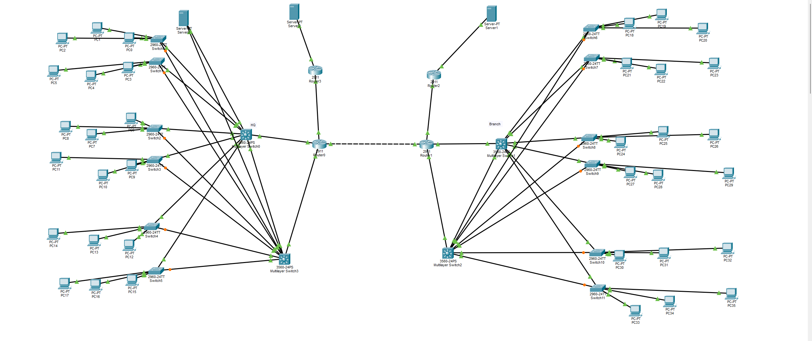

**End-to-end connectivity** — a PC at each site reaching, in one window, its own gateway, a PC in another VLAN, a PC at the far site across the WAN, and the internet — all 0% loss. One shot that exercises VLANs, inter-VLAN routing, OSPF across the WAN, and NAT together.
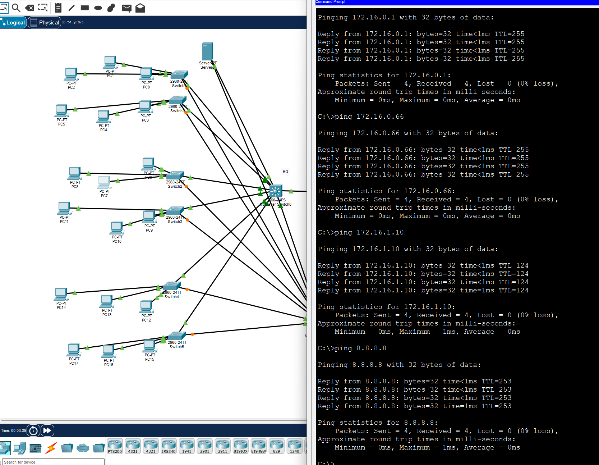
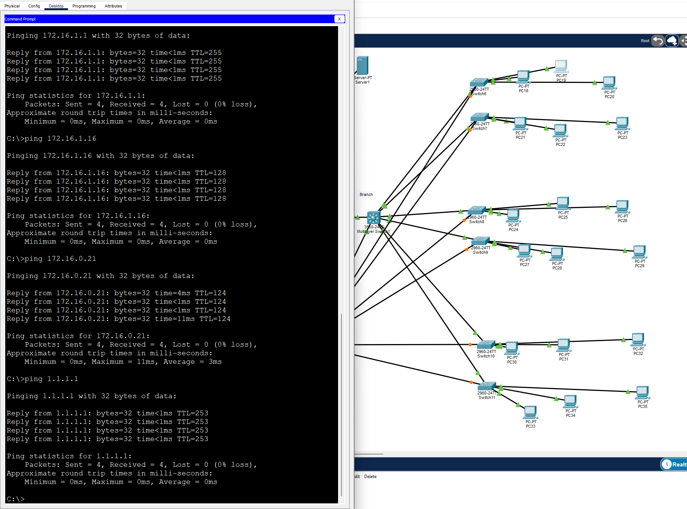

**DHCP over the WAN** — a branch PC pulling a 172.16.1.x address from the HQ DHCP server via `ip helper-address` relay across the WAN.
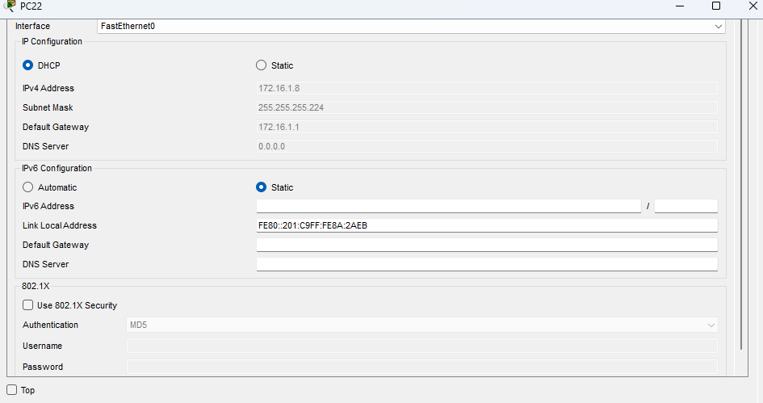

**NAT / PAT** — `show ip nat translations` on each edge router: private addresses translated to that site's single public IP with port numbers.
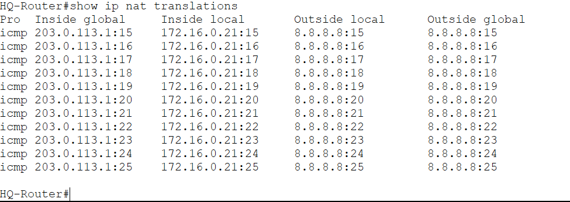
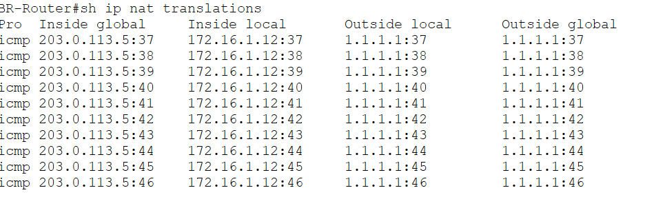

**OSPF** — FULL adjacencies at each site, and the branch routing table showing cross-site `O` routes **and** redundant dual paths to the branch VLANs (via both distribution switches).
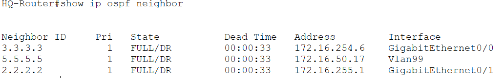
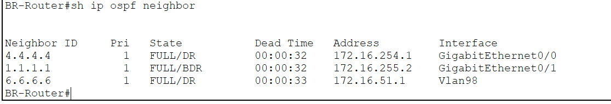
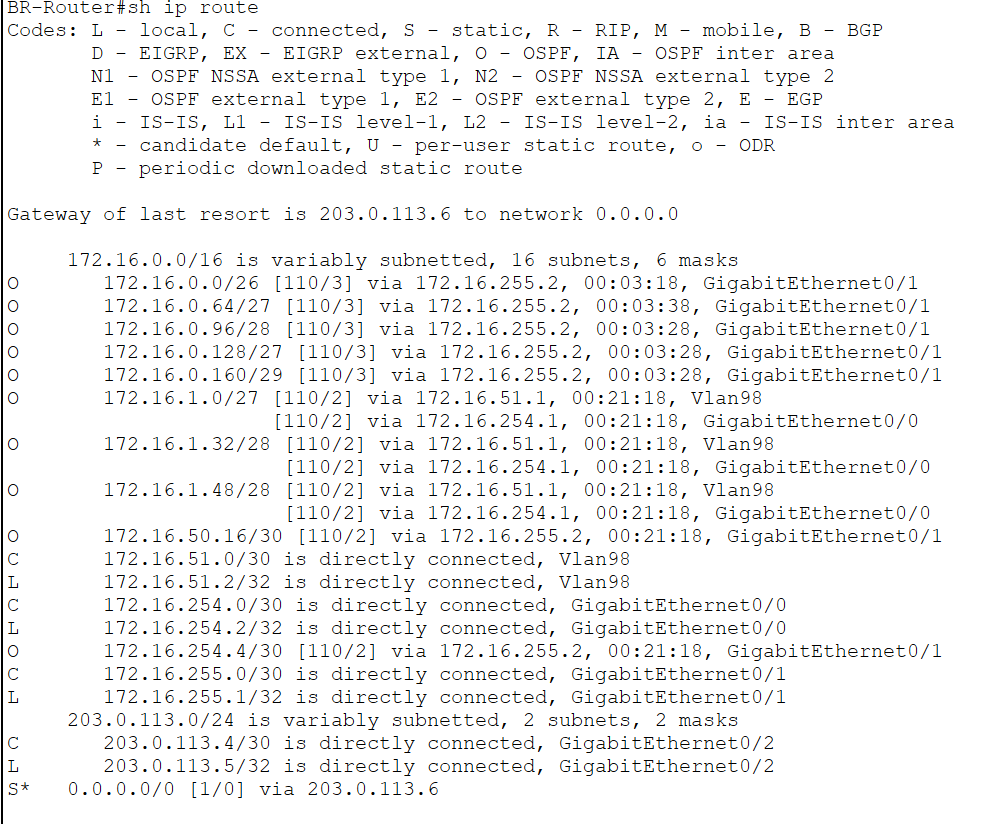

**HSRP failover** — a continuous ping surviving the loss of the primary distribution switch (a few dropped packets, then recovery), with the backup switch's own log showing each VLAN transition **Standby → Active**.
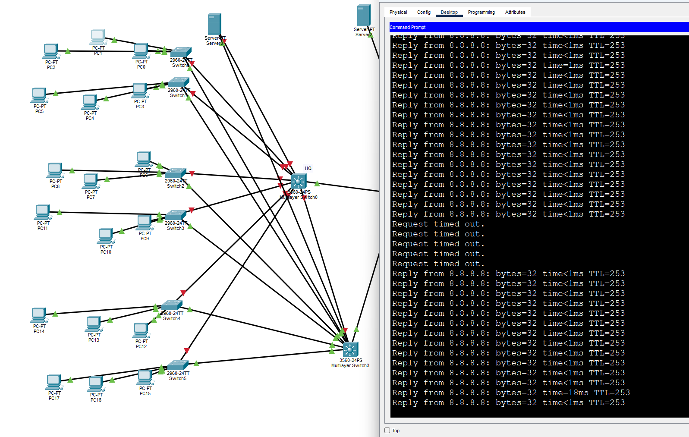
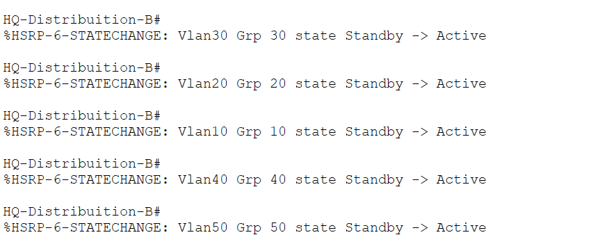
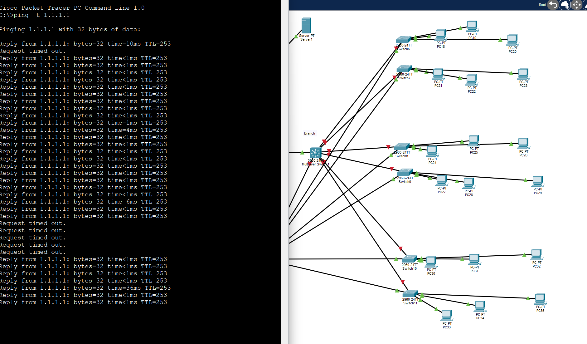
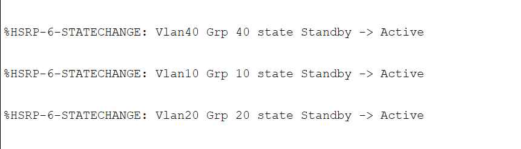

**Spanning Tree** — `show spanning-tree vlan 10` confirming the intended root bridge at each site.
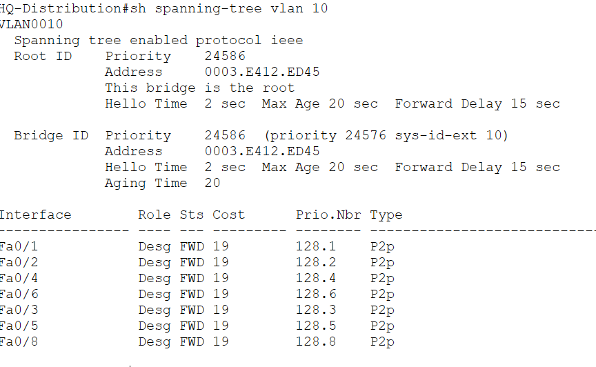
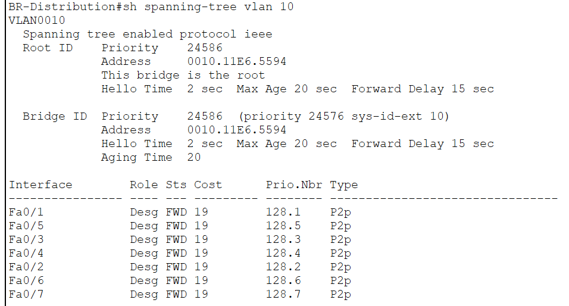

---

## Troubleshooting Log

The real learning happened here. Each of these was a genuine failure I had to diagnose.

**DHCP failing across the WAN — root cause was routing, not DHCP.**
Branch PCs couldn't pull addresses from the HQ server. I kept treating it as a DHCP problem, but the real issue was that OSPF hadn't fully converged — the last adjacency (Branch router ↔ Branch distribution switch) never formed, so Branch had no route to the HQ server. **Lesson:** DHCP relay depends entirely on routing, and pinging directly-connected links doesn't prove OSPF works — only end-to-end `O` routes in the table do.

**Server couldn't reach its own gateway.**
I'd configured the VLAN's SVI (the gateway) but never assigned the server's switch port to that VLAN, so the server was stranded in VLAN 1. **Lesson:** the SVI is the gateway, but the access port is the doorway — you need both.

**Server on a trunk port.**
I accidentally configured the server's port as a trunk. The server's untagged frames landed in the native VLAN (1) instead of VLAN 30, so it couldn't reach anything. **Lesson:** end devices get access ports; only switch-to-switch links are trunks.

**OSPF wildcard mismatch.**
A wrong wildcard mask meant OSPF wasn't advertising the right networks, so the two sites couldn't see each other's routes. **Lesson:** the wildcard is the inverse of the subnet mask, and getting it wrong silently breaks advertisement.

**Default route pointing to an unreachable next-hop.**
I pointed the distribution switch's default route at the edge router's *public* (outside) interface, which the switch had no route to — so the route never installed ("gateway of last resort is not set"). Fixing the next-hop to the router's *inside* interface solved it. **Lesson:** a static route's next-hop must be an address you can already reach.

**VLSM boundary errors.**
Tried to place a /27 subnet on an address that wasn't a multiple of its block size. **Lesson:** every subnet must start on a multiple of its block size (256 − mask).

**Redundant gateway unreachable — a wrong mask on one SVI.**
After enabling HSRP, most VLAN 10 PCs couldn't ping their gateway (.1) or reach the internet, but they *could* ping the standby switch's real IP. Since the virtual IP and the active switch's real IP both live on the same switch, the fault was isolated to that one interface. The VLAN 10 SVI on the active distribution switch had a **/30** mask (255.255.255.252) instead of **/26** (255.255.255.192). With a /30, the switch treated only two addresses as local, so pings from PCs above that range arrived fine but their replies got routed out the default route instead of back to the PC. **Lesson:** a Layer 3 interface's mask must match its subnet exactly — a too-small mask lets traffic *in* but silently misroutes the *reply*, which looks exactly like a dead gateway. I isolated it by pinging each switch's real IP separately from the virtual, which pointed straight at the one bad interface.

---

## What I Learned

Building this end to end changed how I think about networks. The biggest shift was learning to **isolate faults by layer** — prove Layer 1/2 before Layer 3, prove routing before services like DHCP — instead of guessing. I also came away understanding *why* each piece exists: why DHCP needs a relay to cross a router, why NAT hides an entire private network behind one public IP, and why redundancy means pairing a virtual gateway (HSRP) with loop management (STP).

## Future Enhancements

- Security ACLs enforcing inter-VLAN and DMZ policy (e.g., isolating the server VLAN, blocking DMZ-to-LAN initiation)
- Redundant edge routers and dual WAN links
- Port security and DHCP snooping on the access layer
- A public-facing DMZ web server with controlled inbound access
